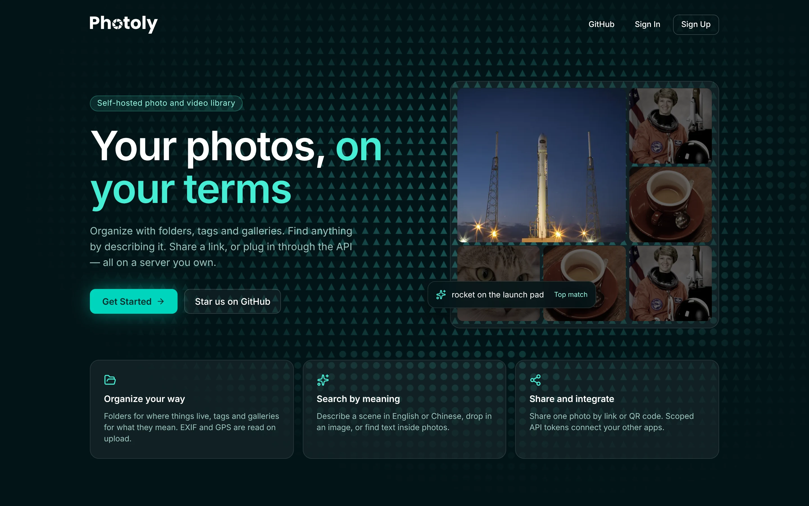

# Photoly

Photoly is a self-hosted photo and video library. Organize media with folders, tags and galleries, share selected items, and search names, metadata and visual content. A documented REST API supports integrations.

Photoly是一款非常美丽的图床网页应用。随着人们对可靠的 自助图片托管应用需求增加，Photoly应运而生。使用 Photoly，您可以轻松管理图片和视频，并使用标签、图库和文件夹对图片和视频进行分类；利用搜索功能，充分探索您的媒体库。此外，Photoly 还提供 API，方便您将我们的功能嵌入到其他应用程序中。

## Features
- Upload Photo / Video, and store them in folders
- Attach a Photo / Video with a Gallery or a Tag
- Add optional Gallery descriptions (up to 5,000 characters of plain text with line breaks), editable in New/Edit Gallery and displayed only in gallery details
- Share a Photo / Video using a share link, or a QR code
- Automatic record photo's Exif information, including GPS location, Camera Model, Lens Model, ISO, Shutter, Aperture, etc.
- Display a Photo Location Map
- Smart Search combines photo/video names, tags and galleries with optional semantic search; existing search modes remain available
- Similar photos and videos, including five-frame video indexing and per-media recommendation state
- On-demand multilingual text recognition with editable, saved results and copy support (Tesseract CPU)
- Optional Smart Organization camera/lens labels and time/location-based trip galleries
- Opt-in private People albums with YuNet/SFace face grouping, persistent names and manual corrections; server or browser inference
- Circular avatar crop preview with square 512 × 512 JPEG output
- Create API to operate your photo using REST API

## Screenshots

## Specifications

One Go binary (`photoly`) plus PostgreSQL 17 with pgvector 0.8.7. AI search uses SigLIP2 on ONNX Runtime, in the server or in the user's browser (the administrator chooses where each model runs).

Frontend: Vue 3 + TypeScript + Tailwind CSS + shadcn-vue (installable PWA)

## How to Run?

1. Copy `.env.example` to `.env` and set the three PostgreSQL passwords (administrator, migration, application) and the administrator account.
2. Run `docker compose up -d --build` from this directory. The `backend` container holds `photoly` and PostgreSQL; `web` serves the frontend.
3. Open `http://localhost:5200`. The API is available at `http://localhost:8384`, with interactive [Swagger UI](http://localhost:8384/docs/) and an [OpenAPI document](http://localhost:8384/openapi.json).
4. Sign in with `ADMIN_EMAIL` and `ADMIN_PASSWORD` from `.env`.

`photoly serve` migrates the schema and seeds settings and the administrator on start; repeated starts preserve records, passwords and settings. PostgreSQL data lives in the `postgres_data` volume, media in `./upload_data`, downloaded model weights in `photoly_models`. Never use `down -v` on a production deployment.

For access from another machine, open `http://<server-address>:5200`. The frontend uses its same-origin `/api` proxy, so browser API requests follow the address used to open the site. Set `PUBLIC_BASE_URL` to an externally reachable API URL for backend-generated share links (for example, `http://<server-address>:5200/api`).

### AI

AI starts disabled. In **AI Management**, enable it, choose per model whether it runs on the server, in browsers, or by user choice, grant user access and activate a search profile. See [AI operations](docs/docs/administration/ai-management.md).

### Upgrading an existing PostgreSQL deployment

Back up the database and media together, rebuild and restart. A database created by the earlier Python release must be at Alembic `0008_upload_activity` before the first start; `photoly serve` adopts it without changing the schema.

### Development and tests

Frontend: `docker compose -f compose.dev.yml up -d --build`, then `pnpm dev` in `photoly_frontend_vue` (see [frontend development](photoly_frontend_vue/README.md)). Server: Go 1.24 in `photoly_server`; `go test ./...` needs `TEST_DATABASE_URL` for the database-backed tests and the ONNX Runtime library for the AI worker test. Database access goes through sqlc: edit `photoly_server/internal/db/queries/*.sql` and run `devbox run -- sqlc generate` in `photoly_server` (CI fails if `internal/db/gen` is stale).

## License
See [LICENSE](LICENSE).
