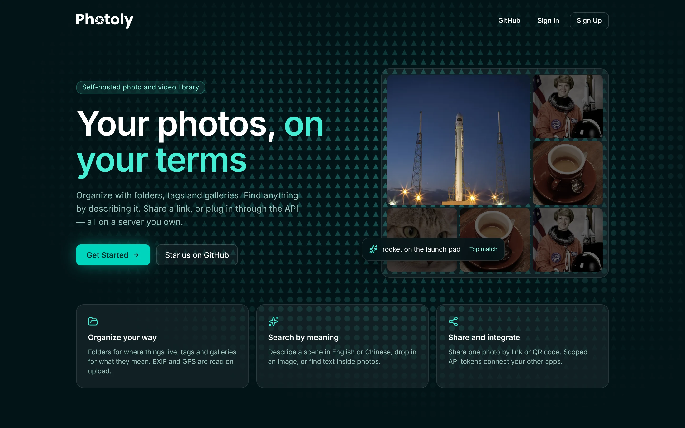

# Photoly

Photoly is a self-hosted photo and video library. Organize media with folders, tags and galleries, share selected items, and search names, metadata and visual content. A documented REST API supports integrations.

Photoly是一款非常美丽的图床网页应用。随着人们对可靠的 自助图片托管应用需求增加，Photoly应运而生。使用 Photoly，您可以轻松管理图片和视频，并使用标签、图库和文件夹对图片和视频进行分类；利用搜索功能，充分探索您的媒体库。此外，Photoly 还提供 API，方便您将我们的功能嵌入到其他应用程序中。

## Functionalities
- Upload Photo / Video, and store them in folders
- Attach a Photo / Video with a Gallery or a Tag
- Share a Photo / Video using a share link, or a QR code
- Automatic record photo's Exif information, including GPS location, Camera Model, Lens Model, ISO, Shutter, Aperture, etc.
- Display a Photo Location Map
- Smart Search combines photo/video names, tags and galleries with optional semantic search; existing search modes remain available
- Similar photos and videos, including five-frame video indexing and per-media recommendation state
- On-demand multilingual text recognition with editable, saved results and copy support (Tesseract CPU)
- Optional Smart Tag camera/lens labels and time/location-based trip galleries
- Circular avatar crop preview with square 512 × 512 JPEG output
- Create API to operate your photo using REST API

## Screenshots


## Specifications

DB: PostgreSQL 17 + pgvector 0.8.7 + Redis

Backend: Python 3.12 + Flask (application factory, Controller / Service / Entity)

Frontend: Vue 3 + TypeScript + Tailwind CSS + shadcn-vue (installable PWA)

## How to Run?

The backend has been migrated from Spring Boot to Flask. This version supports **fresh deployments**; it does not migrate legacy AES passwords or Redis sessions. The original Java implementation is available in Git at `e6619ab`.

### Docker

1. Copy `.env.example` to `.env` and set database, Redis, administrator and both internal AI token values. Use separate PostgreSQL administrator, migration and application passwords. The Redis password must be URL-safe because it enters a connection URL.
2. Run `docker compose up -d --build` from this directory.
3. Open `http://localhost:5200`. The API is available at `http://localhost:8384`, with interactive [Swagger UI](http://localhost:8384/docs/) and an [OpenAPI 3.2 document](http://localhost:8384/openapi.json).
4. Sign in with `ADMIN_EMAIL` and `ADMIN_PASSWORD` from `.env`.

PostgreSQL bootstrap installs pgvector and creates separate schema-owner and application roles. The one-shot `migrate` service runs Alembic and seeds settings/admin before Gunicorn starts. The Web process only checks the schema and cannot execute DDL. Repeated startup preserves records, passwords and settings. PostgreSQL uses `postgres_data`; media remains in `./upload_data`. This is a fresh deployment, with no MySQL data import tool.

The administrator dashboard displays PostgreSQL, pgvector and the schema revision using `/admin/pingDatabase` and `/admin/databaseInfo`.

For access from another machine, set `PUBLIC_BASE_URL` to the externally reachable API URL and update the frontend `VITE_APP_BASE_URL` build setting before rebuilding. `localhost` is only appropriate for local access.

### Optional AI runtimes

Docker Compose **2.24.4+** is required. Set separate `AI_INFERENCE_TOKEN` and `AI_CONTROL_TOKEN` in the root `.env`, including for configurations where Compose validates inactive AI services. Choose the runtime once with `COMPOSE_PROFILES` in `.env`, then use plain `docker compose up -d --build` from the repository root:

| Deployment | `.env` setting | Requirements |
| --- | --- | --- |
| Base library + OCR | leave `COMPOSE_PROFILES` unset | No model runtime required |
| NVIDIA CUDA | `COMPOSE_PROFILES=ai-cuda` | NVIDIA GPU and container runtime |
| CPU | `COMPOSE_PROFILES=ai-cpu` | CPU-only inference image |
| Apple Silicon MPS | `COMPOSE_PROFILES=ai-mps` and `AI_RUNTIME_URL=http://host.docker.internal:8090` | Start the native runtime first, as below |

Enable only one AI profile at a time.

For MPS, use a native ARM64 macOS 14+ shell with `uv` installed:

```sh
sh photoly_backend/scripts/mps-runtime.sh install
sh photoly_backend/scripts/mps-runtime.sh check
sh photoly_backend/scripts/mps-runtime.sh start
```

Keep `start` running in its terminal and run `docker compose up -d --build` in another. Docker connects to `AI_RUNTIME_URL`; the native runtime defaults to `0.0.0.0:8090`, authenticated with the same two tokens. See [runtime setup and troubleshooting](docs/ai-backend-operations.md).

AI starts disabled. In **AI Management**, configure the device (`cpu/float32`, `cuda/bfloat16`, or `mps/float32`), explicitly load a model, grant user access and activate a search profile. Startup alone does not download weights. SigLIP2 is recommended for 16 GB Macs; Qwen video queries can exceed the 60-second deadline under memory pressure.

### Upgrading an existing PostgreSQL deployment

Back up the database and media together. `COMPOSE_PROFILES` in `.env` keeps every command on your deployment's AI profile:

```sh
docker compose stop backend upload-worker ai-scheduler ai-maintenance
docker compose build
docker compose run --rm migrate
docker compose up -d
```

For base deployments, stop only `backend`. For MPS, stop the native runtime, rerun its `install` command after dependency changes, and restart it before the final Compose command. If migration fails, resolve it before starting the new application services.

Alembic `upgrade head` includes video frame vectors (`0003_video_vectors`), OCR (`0004_photo_ocr`) Smart Tag (`0005_smart_organization`), and uploads/storage groups (`0006_uploads_storage`). Existing image vectors are retained. Rebuild the application images to include FFmpeg, Tesseract language data and the offline city index. Never use `down -v` to upgrade a production deployment.

### Development and tests

See [backend setup and architecture](photoly_backend/README.md), [frontend development](photoly_frontend_vue/README.md) and [API compatibility notes](photoly_backend/COMPATIBILITY.md).

Database tests require real PostgreSQL and an Alembic-created schema. Run from the repository root:

```sh
docker compose -p photoly-test -f compose.test.yml build tests backend migrate smoke upload-worker ai-runtime ai-scheduler ai-maintenance
docker compose -p photoly-test -f compose.test.yml run --rm tests
docker compose -p photoly-test -f compose.test.yml run --rm smoke
docker compose -p photoly-test -f compose.test.yml down -v --remove-orphans
```

The integration database is `photoly_test`; the HTTP server uses `photoly_http_test`. Both are temporary and isolated from production. The final HTTP test deliberately stops its own Gunicorn server. Only run cleanup with the explicit test project and Compose file above.

## License
See [LICENSE](LICENSE).


## Search, recognition and smart organization

**Smart Search** is the default search mode: one text box, up to 100 results, with name/tag/gallery matches shown first and semantic results fused when available. Semantic failure preserves text results. See [AI operations](docs/ai-backend-operations.md) for indexing, quotas, model lifecycle and mixed photo/video search.

Scroll down in the viewer to load **Similar photos and videos**. Each item has independent results and scroll state. Returning within 30 seconds of leaving restores it; after that it starts collapsed. Viewing an item continuously does not expire it. **Back to top** collapses recommendations and clears that item's cache.

**Extract Text** runs only when requested. Tesseract recognizes simplified/traditional Chinese, English and Japanese on CPU, independently of AI permissions or the model runtime. Results are saved and can be edited or copied. See [OCR limits and operation](docs/ocr.md).

**Smart Tag** requires global AI, administrator Smart Tag, user AI permission and personal Smart Tag to be enabled. Both Smart Tag switches default off. It runs inside the existing scheduler process, with no extra container or model inference. Turning it off retains editable results. See [rules, controls and offline city attribution](docs/smart-tag.md).

### Bulk uploads and storage groups

Files, folders and ZIPs can be uploaded in unlimited-count batches. The global Upload activity panel stays available while browsing. Each account inherits a default 50 GB group quota, with administrator-managed groups and personal overrides. See [uploads, storage, migration and worker operations](docs/uploads-storage.md).

### Dates and folder details

**Organize → Dates** brings together the signed-in user's photos across all folders. Latest/Oldest
uses EXIF capture time, falling back to upload time; records with neither appear last under Undated.
Dates loads 100 photos per page. Changing the sort, editing a photo or completing an upload refreshes
the feed. The photo viewer's **Open folder** link returns to the containing folder.

Right-click a folder and choose **Details** to view recursive photo,
video and subfolder counts. Storage separates original files from thumbnails and excludes avatars
and temporary files. Missing expected files are reported as incomplete totals. Places are approximate
nearby towns derived from GPS; cameras and lenses come from photo metadata, with counts per photo.

The new owner-only endpoints are `GET /photo/getByDate` (with optional `from`/`to` day range), `GET /photo/getDateDays` and `GET /namespace/getDetails`; see `/docs`
for parameters, pagination and response schemas. No new migration is required beyond `0006_uploads_storage`.
When deploying with Compose overrides, mount the same media directory on `backend`, `migrate`,
`upload-worker` and the maintenance service. Validate the merged configuration with `docker compose config --quiet`
using your deployment's existing project, environment file, overrides and AI profile before restarting it.
