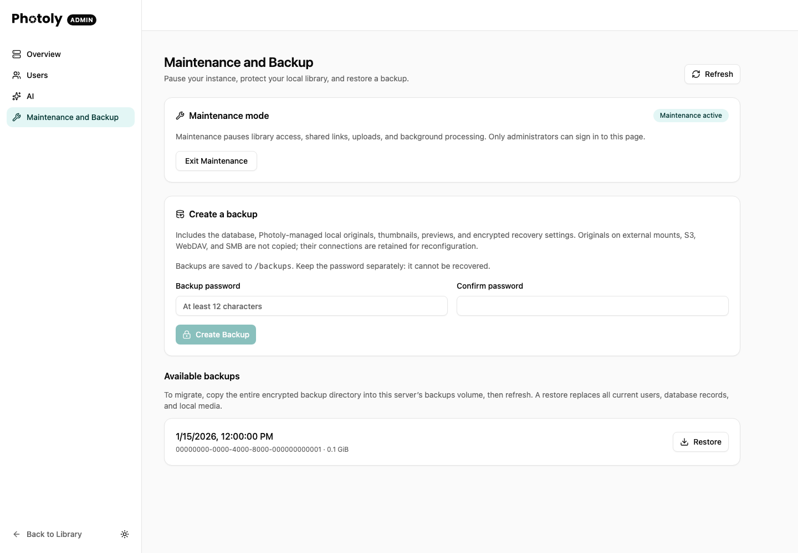

Administrators can open **Maintenance and Backup** in the admin sidebar. This first version creates password-encrypted full backups and restores an entire instance. It does not schedule backups or merge individual users.

## Enter maintenance

Entering maintenance immediately stops new library, upload, shared-link and API-credential requests. Photoly drains active HTTP requests and stops its background workers before enabling backup and restore. Administrators can still sign in to the maintenance page. Other admin changes are also blocked.

If draining takes more than two minutes, the page reports that it is still waiting. **Return to Service When Ready** requests a return after those operations have stopped; it never starts a second set of workers over the old ones.

Maintenance survives restarts and remains enabled after a task succeeds or fails. Inspect the result, then explicitly exit maintenance. Only one backup or restore can run at a time.



*This screenshot uses a simulated maintenance state and a fictional backup. No backup was created or restored to make this image, and no password is shown.*

## Create and verify a backup

1. Enter maintenance and wait for **Maintenance active**. Resolve any capability problems shown on the page.
2. Enter the backup password twice, then choose **Create Backup**.
3. Watch the task's stage and result. While a task runs, backup, restore and exit controls are unavailable.
4. After success, use **Refresh** to inspect **Available backups** and copy the complete encrypted directory to independent storage.
5. Choose **Exit Maintenance** when you are ready to resume service. Completing a backup does not exit automatically.

A failed task remains visible for inspection. Resolve the reported problem before starting again; do not treat an incomplete directory as a restorable backup.

## What is included

- PostgreSQL data, including accounts, permissions, albums, notes and AI results.
- Every Photoly-managed local user directory, including originals and Live Photo companions.
- `.assets`, including persistent thumbnails, previews and avatars.
- Encrypted recovery metadata, version information, file checksums and the storage-credential encryption key.

External local mounts, S3, WebDAV and SMB originals are **not** copied. Their database configuration is included, but restored external sources are disabled until an administrator verifies their connections. Remote caches, models, temporary uploads and unfinished filesystem transactions are not included. Unresolved transaction work or missing managed originals prevents backup.

Do not let other applications modify Photoly-managed directories during maintenance. Maintenance only controls Photoly's own operations.

## Storage and passwords

The standard, development and demo Compose configurations mount the `photoly_backups` named volume at `/backups`. The application uses UID 65532. `BACKUP_DIR` configures the path for non-Compose deployments. The directory must not overlap media, database, model or externally bound storage directories.

To use a separate disk, replace the backend backup mount with a bind mount:

```yaml
volumes:
  - /srv/photoly-backups:/backups
```

Create the directory and grant UID 65532 access before starting the service. A separate volume on the same physical disk does not protect against disk failure. Keep an independent copy of completed backups.

Enter and confirm a password of at least 12 characters for each backup. Passwords are not saved by Photoly. Keep the password separately; a lost password cannot be recovered. Use HTTPS when accessing the administration page across a network.

Each completed backup has a UUID directory containing encrypted archives, sequential parts no larger than 4 GiB, an encrypted manifest and a completion marker. Copy the **entire directory**. Individual parts are not independent archives. A `.partial-*` directory represents an interrupted or failed backup and is never offered for restore. The first version restarts interrupted backups rather than resuming them.

## Restore and migration

Docker Desktop or a remounted local filesystem can assign new inode numbers to
unchanged media. Before serving requests or starting workers, Photoly checks the
default local library roots. If a root identity changed, it verifies the saved
SHA-256 checksums of all managed originals and Live Photo companions, then rebuilds
file and folder identities in one transaction. Media IDs, albums and notes remain
intact. This verification can delay startup for large libraries; ordinary starts
with unchanged root identities do not hash media. External sources are untouched.
Missing files, changed or absent checksums, symlinks, and unverified content in a
previously empty library are not accepted. Failed verification leaves identities intact
and logs `local storage identity check`; the affected source remains unavailable.
Restore the expected files before restarting, and keep other applications from
modifying the managed library during verification.

Copy a completed backup directory into the destination backup volume and refresh the page. Enter maintenance, select **Restore**, enter its password and confirm replacement of all current users, database records and local media.

The destination must have the same schema revision, PostgreSQL major version and pgvector version. Restore does not upgrade an older backup. Deploy a compatible Photoly release first.

Photoly verifies the encrypted data and file inventory, restores media into a private staging directory and restores PostgreSQL into a staging database. Only after validation does it switch the instance. The media filesystem needs free capacity for the restored files in addition to the current library; PostgreSQL needs space for both databases. The default filesystem reserve is 512 MiB. Previous data is retained after a successful restore; the first version does not remove rollback data automatically.

The original `/photoly` mount remains in place. Restored filesystem identities are rebuilt while media IDs and database relationships are preserved. Old login sessions are removed, temporary uploads are marked interrupted, and worker leases are reset. Sign in with an administrator account from the backup, verify the result, configure external connections, then exit maintenance.

Identity rebuilding is finalized against the installed media paths after the directory switch, with original-content checksums verified before committing. On the first startup after upgrading an older completed restore, Photoly also performs this check once to repair stale staging identities. This does not re-import photos or change their IDs. If any required checksum is absent or differs, the repair is rolled back and the service stays in maintenance with a recovery error; it does not silently bypass the storage identity checks. External sources are excluded from this repair.

When restoring saved storage credentials, configure `STORAGE_SECRET_KEY` on the destination. Photoly decrypts credentials with the source key inside the encrypted backup and encrypts them with the target key; it never overwrites deployment environment variables.

The AIO image derives its PostgreSQL management connection from its existing administrator configuration. Standalone deployments must supply a PostgreSQL URL in `BACKUP_DATABASE_URL` for a role capable of exporting all data, creating databases, installing the required extension, assuming the migration role, terminating instance connections and renaming the instance databases. The ordinary application role is not elevated. PostgreSQL 17 client tools are included in the images.

## Offline recovery

Stop the backend before invoking the offline command with the same media, backup mounts and database configuration. PostgreSQL must remain available. For AIO deployments, use a recovery container or otherwise run PostgreSQL separately while the normal application is stopped.

```sh
photoly restore BACKUP_UUID < /secure/path/backup-password
photoly restore rollback
```

The first line of stdin is the password; do not put it on the command line. The command leaves the instance in maintenance. `rollback` restores the most recent retained pre-restore instance; it replaces changes made since that restore.

The backup volume contains `.control` for the instance lock, maintenance state, task records and restore journal. Do not remove it during an operation. After a process interruption, Photoly rolls back an incomplete switch before migrations or background tasks start. A recovery failure keeps the service unavailable until offline recovery succeeds.

Only restore backups from a trusted Photoly administrator. A PostgreSQL dump includes executable database definitions.

## Verification and scale testing

The integration harness in `photoly_server/tests/backup` uses a disposable PostgreSQL container. It covers encryption, split archives, real database backup/restore, credential re-encryption, exclusivity and process termination at database/media switching boundaries.

`BACKUP_SCALE_FILES=200000` or `500000`, together with `BACKUP_SCALE_BYTES`, enables the archive scale test. It generates distinct random bytes to avoid misleading compression results. File-count and byte-throughput measurements are separate from database/API capacity and must be run on representative storage. A multi-terabyte test needs space for originals, backups and restored files.

Run the database/archive suite with Docker:

```sh
photoly_server/tests/backup/run.sh
BACKUP_SCALE_FILES=200000 BACKUP_SCALE_BYTES=4096 photoly_server/tests/backup/run.sh
```

For the actual browser flow, install frontend dependencies and Playwright browsers, then run `photoly_server/tests/backup/browser.sh`. This builds an isolated AIO instance on port 18384 with disposable volumes. It refuses to reuse an existing test container. The test creates a backup, restarts the instance, changes data, restores through the UI, logs in again and downloads restored media. Desktop and mobile/dark screenshots are written to `/tmp/photoly-maintenance-*.png`.

Initial controlled validation used 2,000 files of 8,192 random bytes each (16.38 MB), with a 4 MiB test split threshold: approximately 0.87 seconds to archive and 1.58 seconds to restore, with 361 MB of Go heap observed after the run. These are local archive measurements, not a peak-RSS measurement, a 200,000/500,000-record database benchmark, or a multi-terabyte throughput result. Production uses the fixed 4 GiB threshold.
