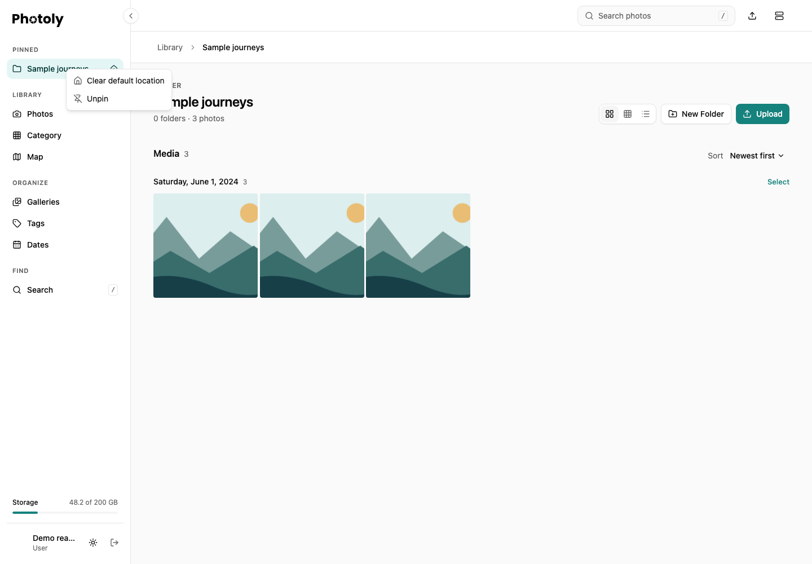

## Dates

**Organize → Dates** shows your photos from all folders in one place.

### Sorting

- **Latest** and **Oldest** use the EXIF capture time. If there is none, they use the upload time.
- Photos with neither date show last, under **Undated**. This section expands on request.
- Year and month headings show photo totals.

### Browsing

- Years start expanded.
- Only the first month in the chosen order opens at first. You can open more months.
- Each month card shows up to ten thumbnails. On phones, it shows up to five.
- Thumbnails load only near the viewport. Collapsed months load no photo pages.
- Photos load in pages of 100 per day. Pages off screen keep their layout but release their cards.
- The page cache holds 20 pages. Visible pages stay while in use.

### Calendar

The floating calendar shows monthly and daily counts.

1. Choose a year and month.
2. Click a day to jump to it. Photoly does not load earlier photos.

Hide the calendar to leave a small restore button. The device remembers this choice.

### Selection and refresh

- Selection survives page recycling.
- **Select All** applies to loaded photos only. It does not apply to the whole library.
- Changing the sort, editing a photo or finishing an upload refreshes the counts and the loaded content.
- **Open folder** in the photo viewer returns to the folder that holds the photo.

## Folder details

Right-click a folder and choose **Details**.

- Photo, video and subfolder counts are recursive.
- Storage shows originals and thumbnails separately. It excludes avatars and temporary files.
- If expected files are missing, the totals are marked incomplete.
- Places are approximate nearby towns from GPS data.
- Cameras and lenses come from photo metadata. Counts are per photo.

## Pinned folders and default location

On desktop, right-click a folder and choose **Pin to sidebar**. It appears under **Pinned** for quick access. Right-click the pinned entry and choose **Set as default location** to open that folder when entering Photos without a specific folder link.

The house marker identifies the default. **Clear default location** keeps the pin; **Unpin** removes the shortcut and also clears the default if it referred to that folder. Neither action moves or deletes media. Pins and the default are saved to your account and are read on other devices; the pinned sidebar itself is a desktop feature.

An explicit folder link takes priority over the default. If the default is unavailable, Photoly falls back to the library root. Renaming or moving a folder keeps its pin attached to the folder ID. Deleted or inaccessible entries are no longer usable.

*This example uses a fictional account, folder and synthetic illustrations.*

## API

These endpoints are for the owner only:

- `GET /photo/getDateSummary`
- `GET /photo/getByDate`
- `GET /photo/getMonthPreview`
- `GET /namespace/getDetails`

For parameters, pagination and responses, see Swagger UI at `/docs`.

For database changes and upgrade steps, see [Upgrading](../install/upgrading.md).
