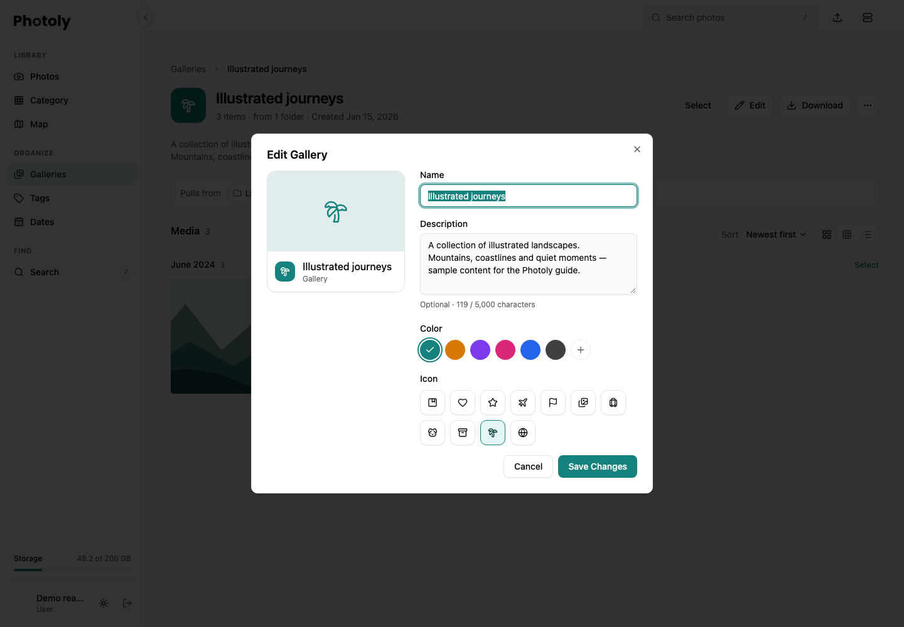
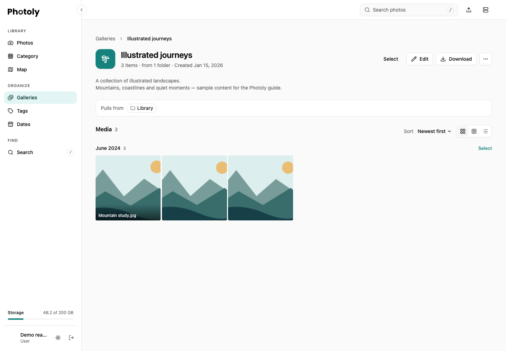

Galleries collect media from different folders without moving or duplicating the originals. Open **Organize → Galleries**. Use **All**, **Created by you** or **Smart trips** to filter the list; change the sort to find a gallery by name or creation date.

## Create and describe a gallery

1. Choose **New Gallery** and enter a name.
2. Optionally add a description, select an icon and choose a color.
3. Choose **Create Gallery**, then open the gallery. Add media using the viewer's **Galleries** section or the library selection controls.

To change the description later, open the gallery and choose **Edit**. **Save Changes** saves it; **Cancel** discards the current edit. If saving fails, the dialog keeps your text so you can retry.

Descriptions are plain text, with paragraphs and line breaks, up to 5,000 Unicode characters. HTML and Markdown appear as text. Clear the field and save to remove the description. Descriptions appear on the gallery detail page, below the title; gallery cards stay compact and do not display them.

*The editor uses a fictional gallery and synthetic landscape illustrations.*

## Browse a gallery

Open a gallery to see its description, media count and source folders. Switch among the available grid, table and list layouts. A gallery map appears when its media has valid GPS coordinates; its resize control changes the space used by the map. Selecting a photo opens the same viewer used elsewhere in the library.

*All names, descriptions and media in this example are synthetic.*

A gallery is an account-owned organization tool. Adding a description does not enable public sharing. A photo's share link is controlled separately in its viewer. For automatically suggested trip galleries and manual membership overrides, read [Smart Tag](smart-tag.md). For projections and location controls, read [Maps and locations](maps-and-locations.md).

## Integration behavior

The gallery create/update APIs accept `description`. Omit it on update to preserve existing text; send an empty string to clear it. `null`, non-string values, null characters and more than 5,000 characters are rejected. Gallery listing responses include the description. See [API](../api.md) for the full request and response contracts.
