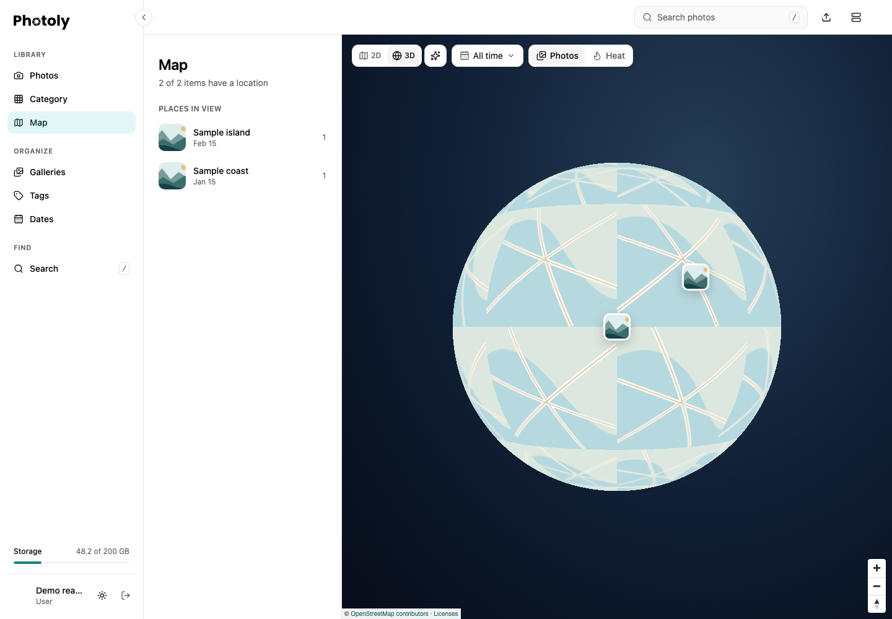
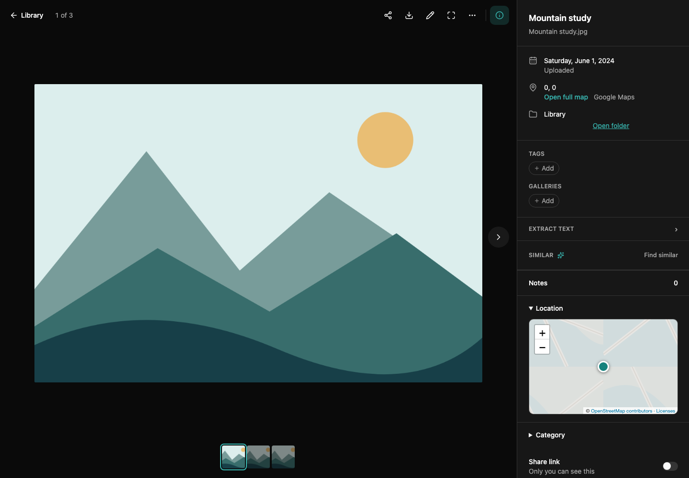

Open **Library → Map** to browse account media with valid GPS coordinates. Media without coordinates is not placed on the map. Location comes from media metadata; Photoly does not infer where an untagged photo was taken.

## Explore the full map

- Switch between **2D** (flat map) and **3D** (globe). The default is the globe. Your browser remembers the projection and shares it with gallery maps.
- Drag to move the map and use the zoom controls or scroll to zoom. On the globe, markers on the far side are hidden until you rotate them into view.
- Choose a date range with **All time**. The selected range controls the displayed photos, places and heat layer.
- Switch **Photos** to **Heat** to see the distribution of locations instead of individual photo markers.
- Use the background control to choose stars, a gradient or a simple background. This preference is stored in your browser.
- The globe has softer brightness and real-time sunlight. Use **Day/night** to toggle the night shading; the choice is remembered and shared with gallery maps. Sunlight follows your device clock and refreshes every minute while the page is visible. Both shading and brightness adjustment fade away as you zoom into cities. Photos and heat overlays remain clear. If day/night rendering is unavailable, the map remains usable.
- Select a place or marker to inspect its photos. Open a photo from the popup to use the full media viewer.

*This capture uses fictional places, synthetic photos and schematic map tiles. It demonstrates the controls, not real geography. Normal deployments load OpenStreetMap tiles; attribution remains visible.*

The places sidebar follows the map viewport. On desktop its resize handle changes the sidebar width. Gallery detail pages offer a map for that gallery's media, using the same projection preference.

## Location in the photo viewer

Open a photo with GPS metadata and show its details. **Location**, between Notes and Category, contains a compact 2D map and a marker. Expand or collapse the section; its folding state is remembered for the current viewing session. The map loads when needed and stays 2D even if the full map uses the globe.

**Open full map** navigates to the library map focused on that photo. The external map link opens the coordinates in the named mapping service. Photos without valid coordinates show neither the location section nor the full-map link. Coordinates `0, 0` are valid and do not mean “missing.”

*The illustration and map tiles are synthetic. Coordinates are the deliberately fictitious sample location `0, 0`; no personal photo or location is used.*

## Availability and privacy

Maps need browser graphics support and access to map tiles. A tile-loading problem can leave the map background incomplete even when media and coordinates are available. Location browsing does not enable sharing or change media visibility. Be mindful that originals and their metadata can include GPS information when you share or download them.

For API integration, the map and place operations are listed under **PhotoExtra** in [Swagger UI](../api.md).
