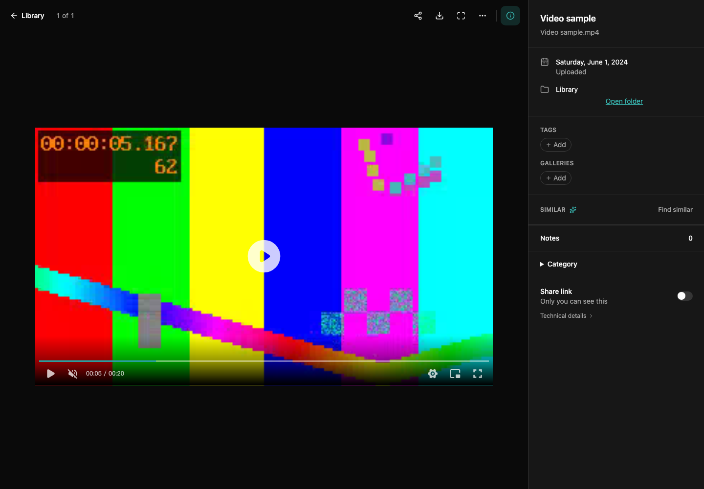

Open a video from Photos, Dates, a gallery or **Category → Videos**. The viewer uses an embedded player with a thumbnail poster. Playback starts when you press Play; opening a video does not autoplay it.

## Controls

Use the timeline to seek, the speaker control for volume, and the settings menu to change playback speed. Fullscreen is available from the player. Picture-in-picture is shown when the browser supports it. On phones, videos play inline and controls remain touch-accessible.

When the player has keyboard focus:

| Key | Action |
| --- | --- |
| Space | Play or pause |
| Left / Right | Seek backward / forward five seconds |
| Up / Down | Increase / decrease volume by 10% |
| Escape | Exit player fullscreen first |

These shortcuts apply inside the player. Typing in a text field or activating a button keeps that control's normal behavior. Moving to another media item or closing the viewer stops the previous player.

*The video is a project-generated test pattern; no personal recording is included.*

## When a video does not play

A thumbnail can be available even when the browser cannot decode the original video's codec. The player does not automatically transcode every video into a browser-supported format. If loading fails, use **Retry** after checking the storage connection, or download the original for a compatible local player. An unavailable external source can also prevent streaming.

The viewer's fullscreen image controls and the video's player fullscreen are separate. **Third-party licenses** in player settings opens the bundled notices. Live Photo motion is a separate feature: see [Media tools](media-tools.md). For thumbnail processing and video categories, see [Categories and private notes](categories-and-notes.md).
